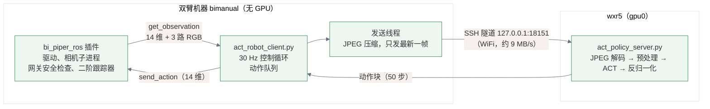

# ACT 远程推理配置说明：wxr5 GPU 推理 → 双臂 Piper 执行

- 日期：2026-11-04
- 策略端：wxr5（`<WXR5_ACT_DIR>/remote_inference`，conda 环境 `ACT`，lerobot 0.6.1），默认用 gpu0
- 机器人端：双臂机器 `bimanual`（`<ROBOT_HOME>/zero-wam/remote_inference_ACT`，用 PICO-ACT 的 `.venv`，lerobot 0.6.1，插件 `--robot.type=bi_piper_ros`）
- 要用的模型：正在 gpu0 上训练的 `act_bipiper_block_plate_test`（数据集 `<HF_USER>/ACT`：40 条，30 fps，14 维关节和夹爪，三路 480×640 相机）。训练结束后的检查点在：
  `<WXR5_ACT_DIR>/outputs/train/act_bipiper_block_plate_test/checkpoints/last/pretrained_model`

---

## 0. 结论先说

训练一结束就可以开始，步骤如下（详细说明见第 3 节）：

```bash
# ① wxr5 上（建议在 tmux 里）
bash <WXR5_ACT_DIR>/remote_inference/start_server.sh
#    看到 "ACT PolicyServer started on 127.0.0.1:18151" 就绪

# ② 双臂机器上（人在现场、急停在手边、CAN 已按 ~/zero-wam/common.txt 配好）
cd <ROBOT_HOME>/zero-wam/remote_inference_ACT
bash start_client.sh --robot.dry_run=true --duration_s=30   # 先空跑：真相机和真反馈，推理照做，但不使能、不下发
bash start_client.sh --duration_s=70                        # 真机执行 70 秒（一条示教平均约 62 秒）
#    Ctrl+C 随时停止：机械臂停在当前实测位置保持
```

---

## 1. 方案说明

### 1.1 为什么用 lerobot 0.6.1 自带的 `async_inference`，没有照搬您给的文档

您给的 <https://huggingface.co/docs/lerobot/main/en/remote_inference> 是 lerobot **main 分支**的新版远程推理：命令是 `lerobot-policy-server` 加 `lerobot-rollout --inference.type=remote`，走 Zenoh 传输。这套东西**还没有进入正式发布的 0.6.1**，而两台机器装的都是 0.6.1：wxr5 上的训练用它，双臂机器上的 `bi_piper_ros`/`pico_vr` 插件和录数据也用它。我核实过，0.6.1 里没有 `lerobot.remote_inference` 模块，也没有 `lerobot-policy-server` 命令。

0.6.1 自带的是上一代远程推理 `lerobot.async_inference`：`policy_server`（GPU 端）加 `robot_client`（机器人端），走 gRPC，思路和新版一样。机器人端只采观测、执行动作，不加载权重；GPU 端加载检查点，每次返回一段动作（action chunk）；机器人端维护一个动作队列，快用完时再发新观测。所以我在 0.6.1 的 `async_inference` 上做了适配，没有升级 lerobot，正在跑的训练和现有的数采、遥操流程都不受影响。以后要换成 main 的 Zenoh 版，见第 7 节。

### 1.2 结构



- 推理服务只监听 wxr5 的 `127.0.0.1:18151`，不对外开端口。双臂机器用一把专用钥匙建 SSH 隧道连进来，这把钥匙在 wxr5 上只允许转发这一个端口，不能登录、不能执行命令。0.6.1 的 gRPC 协议用 pickle 传数据、没有认证，直接暴露端口会有安全问题，所以走隧道。
- 机械臂一侧的安全机制全部照旧，由插件提供：网关的所有权、限位、反馈新鲜度检查，速度 20%，100 Hz 二阶跟踪器（$v_{max}=0.8$ rad/s，$a_{max}=4$ rad/s²）；第一帧动作离当前位置超过 0.03 rad 时，先以不超过 0.3 rad/s 的速度平滑靠过去；超过 1 s 收不到新动作，网关按实测位置保持。

### 1.3 相对 lerobot 原版改了什么，为什么

| 问题（原版 0.6.1） | 实测 / 原因 | 适配做法 |
|---|---|---|
| 每帧观测带三路**原始图像**，约 2.7 MB，而且在控制循环里**同步发送** | 双臂机器走 WiFi，到 wxr5 实测约 9 MB/s，每发一帧要卡住控制循环约 0.3 s | 客户端先把图像压成 JPEG（质量 90），真实画面每帧约 57 KB；放在单独的发送线程里发，只发最新的一帧。服务端解码回 RGB |
| 服务端「观测和上次差不多就跳过推理」的阈值写死为 `atol=1` | 这个值是按 so100 的「度」定的；这里的单位是弧度，1 rad 等于几乎永远跳过，机械臂会一顿一顿地等 | 改成参数 `--similarity_atol`，默认 0（不跳过） |
| 服务端连不上时，原版也会先连接机械臂（启动驱动、使能、回 home） | 握手失败后原版不会断开机械臂，驱动和相机子进程会留在后台 | 先确认服务端可达再连接机械臂；无论怎么退出都会断开机械臂 |
| 服务端掉线后，客户端会一直刷错误 | — | 出错后稍等再重试；动作队列连续空 3 s 就自动停止（`--max_starve_s`） |
| 检查点和机械臂对不上时，要等到推理阶段才报错 | — | 加载检查点时先核对输入特征（`observation.state` 14 维、三路相机的键名和尺寸），对不上直接报错；加载后做一次预热推理；客户端重连时不重复加载同一个检查点 |

协议本身没改，所以原版 `robot_client` 也能连我写的服务端（只是图像不压缩）。

---

## 2. 已经替您完成的配置

### 2.1 wxr5

| 项 | 内容 |
|---|---|
| 安装 | conda 环境 `ACT` 里新装了 `grpcio 1.85.1`，即 lerobot 的 `[async]` 依赖；`protobuf 7.36.2` 原来就有。`pip check` 无冲突。没有改动 lerobot 源码 |
| `remote_inference/act_policy_server.py` | 服务端适配（见 1.3） |
| `remote_inference/start_server.sh` | 启动脚本：优先用 `<WXR5_FAST_DIR>/act_infer/` 下的环境副本（见下一行），没有副本时退回 conda 环境 `ACT`；每次启动先把检查点同步到 `<WXR5_FAST_DIR>/act_infer/ckpt/<训练名>_<步数>/`；`CUDA_VISIBLE_DEVICES=${GPU:-0}`，监听 `127.0.0.1:${PORT:-18151}`，检查点默认用本次训练的 `last`；日志写到 `remote_inference/logs/` |
| `<WXR5_FAST_DIR>/act_infer/`（2026-11-04 晚加的） | `/data0` 是一块很忙的机械盘（每次读平均约 0.2 s），从上面导入 torch 要好几分钟。所以把推理用的东西复制到 NVMe 盘 `/home`：`env/`（`ACT` 环境的完整副本，6.2 GB）、`lerobot_src/`（lerobot v0.6.1 源码副本，12 MB，经 `PYTHONPATH` 优先于 `/data0` 上的可编辑安装）、`ckpt/`（启动时同步过去的检查点，每个约 200 MB）、`copy_env.sh`/`copy.log`/`jobs.txt`（复制脚本和记录）。不用了直接 `rm -rf <WXR5_FAST_DIR>/act_infer`，`start_server.sh` 会自动退回原环境 |
| `remote_inference/test_ckpt/` | **联调用的临时检查点**：用同一数据集在 2 号卡上训了 50 步，模型本身没有意义，**不能上真机**。约 592 MB，不需要了可以删掉：`rm -rf <WXR5_ACT_DIR>/remote_inference/test_ckpt` |
| `~/.ssh/authorized_keys` | 加了一行带限制的公钥（`restrict,port-forwarding,permitopen="127.0.0.1:18151",command="/bin/echo tunnel-only"`，注释是 `<ROBOT_USER>@<ROBOT_HOST> act-remote-inference tunnel`）。修改前的文件备份在 `~/.ssh/authorized_keys.bak_before_act_tunnel_20261104` |

### 2.2 双臂机器 bimanual

| 项 | 内容 |
|---|---|
| 安装 | `PICO-ACT/.venv` 里新装了 `grpcio 1.85.1`、`protobuf 7.36.2`。`pip check` 无冲突，PICO-ACT 的插件和其他文件没有改动 |
| `remote_inference_ACT/act_robot_client.py` | 客户端适配（见 1.3） |
| `remote_inference_ACT/start_client.sh` | 启动脚本：载入 `PICO-ACT/tasks/lerobot_env.sh`（ROS 和 `.venv`）→ 建 SSH 隧道 → 运行客户端；脚本退出时关闭隧道。日志写到 `remote_inference_ACT/logs/` |
| `<TUNNEL_KEY_PATH>` | 新生成的隧道专用钥匙（只用于连 wxr5 的推理端口）；wxr5 的主机公钥已写入 `~/.ssh/known_hosts`，指纹 `<WXR5_HOSTKEY_FINGERPRINT>`，我在两边核对过 |
| `PICO-ACT/runs/20261104T062610Z_lerobot_88e9dbb0/` | fake 联调时插件生成的运行记录，可以删 |

### 2.3 联调结果（不碰硬件）

wxr5 上用测试检查点起服务端（2 号卡，没有动 gpu0 上的训练）；双臂机器上用插件的 fake 后端跑客户端 25 秒。fake 后端不启动驱动和相机、不碰 CAN，相机给黑帧：

| 指标 | 结果 |
|---|---|
| 握手、加载检查点、特征核对 | 通过（`observation.state` 顺序 `left_joint1..6, left_gripper, right_joint1..6, right_gripper`，与数据集一致） |
| 加载检查点 + 预热 | 约 6 s + 1 s（只在客户端第一次连上时发生） |
| 控制循环执行频率 | 29.9–30.1 Hz，动作队列**一拍都没空过** |
| GPU 推理（每次出 50 步动作） | 中位数 18 ms，最大 35 ms；服务端单次总耗时中位数 28 ms |
| 从发出观测到收回动作块 | 中位数 112–125 ms（包括 WiFi、隧道和服务端节拍）；队列里有 25 步以上（约 0.8 s）的余量，足够覆盖 |
| 真实画面 JPEG 大小 | 用数据集的帧估算：左腕 10 KB、右腕 13 KB、场景 34 KB，每帧约 57 KB（原图 2700 KB） |
| 退出 | 到时自动停止，机械臂断开（实测保持），驱动和相机子进程正常关闭，隧道关闭；服务端按 Ctrl+C 能正常退出 |

**还没做的**：真驱动、真相机下的 `dry_run`，以及真机执行。这两步要启动驱动、占用 CAN 和相机，需要您在现场，所以留给您按第 3 节来做。

---

## 3. 训练完成后的使用步骤

### 3.1 确认训练完成、检查点存在（wxr5）

```bash
ls <WXR5_ACT_DIR>/outputs/train/act_bipiper_block_plate_test/checkpoints/
ls <WXR5_ACT_DIR>/outputs/train/act_bipiper_block_plate_test/checkpoints/last/pretrained_model
# 应有 config.json  model.safetensors  policy_preprocessor*.json/.safetensors  policy_postprocessor*  train_config.json
nvidia-smi        # 确认训练进程已退出、gpu0 空出来
```

### 3.2 在 wxr5 上启动推理服务端

```bash
tmux new -s act_srv                        # 断开 SSH 也不会停；离开按 Ctrl+b 再按 d，回来 tmux attach -t act_srv
bash <WXR5_ACT_DIR>/remote_inference/start_server.sh
```

- 用 `/home` 上的副本时：某个检查点第一次启动约 1 分钟（要先把检查点从 `/data0` 复制过来），之后再启动约 5 s；看到 `ACT PolicyServer started on 127.0.0.1:18151` 就绪。客户端第一次连上时才加载模型，加载加预热约 6 s。（用 `/data0` 上的原环境时，盘忙的时候导入要好几分钟、预热要 1 分多钟。）
- 修改了 `/data0` 上训练目录里的检查点（例如重新训练覆盖了同名目录）时，下次启动会自动重新同步。
- 换检查点：把目录当第一个参数传进去，例如中间检查点：
  `bash start_server.sh <WXR5_ACT_DIR>/outputs/train/act_bipiper_block_plate_test/checkpoints/060000/pretrained_model`
  服务端以这里指定的检查点为准，客户端传来的路径只作记录。
- 换卡：`GPU=3 bash start_server.sh`；换端口：`PORT=18152 bash start_server.sh`（客户端也要用同样的 `PORT`，而且隧道钥匙只放行 18151，换端口要同时改 wxr5 上 `authorized_keys` 里那一行的 `permitopen`）。
- 停止：在这个窗口按 Ctrl+C，释放 GPU 要等几十秒。

### 3.3 双臂机器上的准备（现场）

1. 人在现场，急停可用，机械臂周围没有障碍；任务物品摆成和录数据时一样。
2. CAN 按 `~/zero-wam/common.txt` 配好（can0、can2 是 UP）。
3. 没有别的程序占用机械臂和相机（collect、`lerobot_teleop.sh`、`pico_record.sh`、replay 等都要先退出）。插件启动时也会检查，发现冲突会拒绝启动：
   ```bash
   ps aux | grep -E "piper|realsense|robot_infra" | grep -v grep
   ```
4. 在双臂机器上开一个终端（本机桌面终端，或者 SSH 登录后开 tmux 都可以）。

### 3.4 第一步：dry_run 空跑（不动机械臂）

```bash
cd <ROBOT_HOME>/zero-wam/remote_inference_ACT
bash start_client.sh --robot.dry_run=true --duration_s=30
```

这一步会启动两个驱动和三台相机，读真实反馈和真实画面，送到 wxr5 推理，把动作取回来走完跟踪器，但**不使能、不下发任何命令**（插件的 `dry_run`）。要确认的是：

- 日志里出现 `Features OK`（服务端）、`Running. Ctrl+C to stop`（客户端）；
- 每 5 秒一行 `[status] exec 30.0 Hz | queue .. | starved 0/150 ticks | ... | obs->chunk ~120 ms median`：`exec` 接近 30 Hz，`starved` 基本为 0；
- 推理出来的动作合理：在 `PICO-ACT/runs/<时间>_lerobot_*/episode/` 的日志里，`first_action` 一项记着第一帧动作离当前位置有多远（`distance_to_measured_rad`）。训练好的模型从 home 出发时，这个值应当很小（远小于 0.3 rad）。如果特别大，先别上真机，查一下检查点和数据。

### 3.5 第二步：真机执行

```bash
bash start_client.sh --duration_s=20        # 先短跑 20 秒，看动作方向和幅度
bash start_client.sh --duration_s=70        # 完整任务（示教平均每条约 62 秒）
bash start_client.sh                        # 不限时，Ctrl+C 停
```

每次运行的过程：

1. 确认 wxr5 服务端连得上（连不上直接退出，机械臂不会动）；
2. 插件启动驱动和相机 → 自检 → 使能 → 用 4 s 平滑回到 home（六个关节全为 0）；
3. 服务端加载检查点、核对特征、预热（只在第一次连上时做）；
4. 第一帧动作离当前位置超过 0.03 rad 时，先平滑靠过去，然后以 30 Hz 跟随策略输出的动作；
5. 到时、Ctrl+C 或出错时：网关按**实测位置保持**，驱动和相机子进程关闭，隧道关闭。**不会自动失能、回 home 或关夹爪**（与 PICO-ACT 其他流程一致），之后按您平时的方式处理。

注意：

- **只按一次 Ctrl+C**，等它打印 `Client stopped`；收尾时程序会屏蔽第二次 Ctrl+C，防止收尾被打断后驱动和相机进程残留在后台。
- 动作异常时，先按急停，再 Ctrl+C。
- 服务端可以一直开着，客户端可以反复启动；换检查点要重启服务端。

### 3.6 换任务描述或检查点路径（客户端）

ACT 不使用任务文本，这里只用于记录：

```bash
TASK="pick up pens on the table and put them into pen holder" bash start_client.sh
CKPT=/data0/.../pretrained_model bash start_client.sh   # 服务端用 start_server.sh 固定了检查点时，这个只作记录
```

---

## 4. 不用我的脚本、直接用 lerobot 命令

下面是两个脚本实际执行的命令，便于您自己改参数或写进别的流程。

### 4.1 wxr5：服务端

```bash
source <WXR5_CONDA_DIR>/etc/profile.d/conda.sh && conda activate ACT
cd <WXR5_ACT_DIR>/remote_inference
CUDA_VISIBLE_DEVICES=0 python act_policy_server.py \
  --host=127.0.0.1 --port=18151 \
  --fps=30 --inference_latency=0.033 --obs_queue_timeout=2 \
  --policy_path=<WXR5_ACT_DIR>/outputs/train/act_bipiper_block_plate_test/checkpoints/last/pretrained_model \
  --device=cuda \
  --similarity_atol=0
```

lerobot 原版服务端的等价命令（不能解码 JPEG，只能配合原版客户端用；跳过推理的阈值写死为 1）：

```bash
CUDA_VISIBLE_DEVICES=0 python -m lerobot.async_inference.policy_server \
  --host=127.0.0.1 --port=18151 --fps=30 --inference_latency=0.033 --obs_queue_timeout=2
```

### 4.2 双臂机器：隧道和客户端

```bash
source <ROBOT_PROJECT_DIR>/tasks/lerobot_env.sh       # ROS + PICO-ACT/.venv
cd <ROBOT_HOME>/zero-wam/remote_inference_ACT

# SSH 隧道（后台）：本机 18151 → wxr5 的 127.0.0.1:18151
ssh -M -S logs/.tunnel.sock -f -N -o ExitOnForwardFailure=yes -o ServerAliveInterval=5 \
    -i <TUNNEL_KEY_PATH> -L 127.0.0.1:18151:127.0.0.1:18151 <WXR5_USER>@<WXR5_IP>

python act_robot_client.py \
  --robot.type=bi_piper_ros \
  --server_address=127.0.0.1:18151 \
  --policy_type=act \
  --pretrained_name_or_path=<WXR5_ACT_DIR>/outputs/train/act_bipiper_block_plate_test/checkpoints/last/pretrained_model \
  --policy_device=cuda \
  --actions_per_chunk=50 \
  --chunk_size_threshold=0.5 \
  --aggregate_fn_name=weighted_average \
  --fps=30 \
  --task="pick up pens on the table and put them into pen holder" \
  --image_codec=jpeg --jpeg_quality=90 \
  --duration_s=70

ssh -S logs/.tunnel.sock -O exit <WXR5_USER>@<WXR5_IP>   # 用完关闭隧道
```

lerobot 原版客户端的等价命令（可以连上面任意一个服务端；不压缩图像、同步发送，在这条 WiFi 上每帧会卡约 0.3 s，**不建议上真机**，仅供对照）：

```bash
python -m lerobot.async_inference.robot_client \
  --robot.type=bi_piper_ros --server_address=127.0.0.1:18151 \
  --policy_type=act --pretrained_name_or_path=<wxr5 上的检查点路径> --policy_device=cuda \
  --actions_per_chunk=50 --chunk_size_threshold=0.5 --aggregate_fn_name=weighted_average --fps=30 \
  --task="pick up pens on the table and put them into pen holder"
```

### 4.3 不连硬件的联调（可以随时自己复现）

```bash
# wxr5（用临时检查点、2 号卡，别和正式的服务端同时占 18151）
GPU=2 bash <WXR5_ACT_DIR>/remote_inference/start_server.sh \
    <WXR5_ACT_DIR>/remote_inference/test_ckpt/act_smoke/checkpoints/last/pretrained_model
# 双臂机器
cd <ROBOT_HOME>/zero-wam/remote_inference_ACT
CKPT=<WXR5_ACT_DIR>/remote_inference/test_ckpt/act_smoke/checkpoints/last/pretrained_model \
  bash start_client.sh --robot.backend=fake --duration_s=20
```

---

## 5. 参数说明和调参

### 5.1 客户端（`act_robot_client.py` / `start_client.sh`）

| 参数 | 默认 | 含义和建议 |
|---|---|---|
| `--actions_per_chunk` | 50 | 每次推理取 ACT 输出的前多少步（模型的 `chunk_size` 是 100）。越大，越依赖一次推理的开环预测 |
| `--chunk_size_threshold` | 0.5 | 队列剩余不到这个比例（50 × 0.5 = 25 步，约 0.8 s）时开始发新观测。往返时间约 0.12 s，余量充足。想更频繁地按新画面重新规划，可以调到 0.7–0.9 |
| `--aggregate_fn_name` | `weighted_average` | 新旧动作块在同一时刻重叠时怎么合并：`weighted_average`（旧 0.3 + 新 0.7）、`latest_only`、`average`、`conservative`（旧 0.7 + 新 0.3）。动作发抖可以试 `average` 或 `conservative`，反应慢可以试 `latest_only` |
| `--fps` | 30 | 与数据集一致，不要改 |
| `--image_codec` / `--jpeg_quality` | `jpeg` / 90 | `raw` 就是原版行为（太慢）。训练数据是 H.264 视频，质量 90 的 JPEG 与之相当 |
| `--duration_s` | 0 | 运行多少秒后自动停止；0 表示直到 Ctrl+C |
| `--max_starve_s` | 3.0 | 收到过动作以后，队列连续空这么久就停止（服务端掉线、相机或反馈卡住） |
| `--connect_timeout_s` | 10 | 启动时等服务端的时间 |
| `--robot.dry_run` | false | true：驱动和相机照常运行，读反馈、推理都照做，但不使能、不下发 |
| `--robot.backend` | `ros` | `fake`：不碰任何硬件的模拟 |
| `--robot.home_on_connect` | true | 连接时 4 s 平滑回 home |
| `--robot.tracker_max_velocity_rad_s` | 0.8 | 跟踪器的最大关节速度。动作跟不上策略时可以适当调高，但先确认安全 |
| `--robot.tracker_time_constant_s` | 0.08 | 跟踪器时间常数，越大越平滑、越滞后 |
| `--robot.approach_peak_velocity_rad_s` | 0.3 | 第一帧平滑靠近时的峰值速度 |
| `--robot.action_timeout_s` | 1.0 | 超过这么久没有新动作，网关按实测位置保持 |

驱动层的速度百分比（20%）在 `PICO-ACT/profiles/collection/session.json` 里，和录数据时一致，没有改。

### 5.2 服务端（`act_policy_server.py` / `start_server.sh`）

| 参数 | 默认 | 含义 |
|---|---|---|
| `--policy_path` | 本次训练的 `last` | 服务端固定使用的检查点 |
| `--device` | `cuda` | 推理设备（选哪张卡由 `CUDA_VISIBLE_DEVICES`，也就是环境变量 `GPU` 决定） |
| `--similarity_atol` | 0 | 关节状态（rad/m）离上次推理的距离小于它就跳过；0 表示每帧观测都推理 |
| `--inference_latency` | 0.033 | 两次返回动作块的最小间隔（s） |
| `--obs_queue_timeout` | 2 | 等观测的超时时间（s） |
| `--warmup` | true | 加载后做两次空推理 |

---

## 6. 日志和排查

- 服务端日志：`<WXR5_ACT_DIR>/remote_inference/logs/server_<时间>.log`（另有 lerobot 自己写的 `policy_server_<时间戳>.log`）
- 客户端日志：`<ROBOT_HOME>/zero-wam/remote_inference_ACT/logs/client_<时间>.log`（另有 `robot_client_<时间戳>.log`）
- 机械臂插件的运行记录：`<ROBOT_PROJECT_DIR>/runs/<时间>_lerobot_<id>/`，里面有驱动和相机日志、`episode/` 事件日志（每个下发的动作、`first_action`、状态切换），以及 `stack-ended.json`（统计和错误）

| 现象 | 原因 / 处理 |
|---|---|
| `策略服务端 127.0.0.1:18151 在 10 s 内连不上` | wxr5 的 `start_server.sh` 没在跑或还没启动完（要 1 分钟），或隧道没建起来。机械臂不会动 |
| SSH 报 `Permission denied` / `Host key verification failed` | 隧道钥匙或 known_hosts 被改过：检查 `<TUNNEL_KEY_PATH>` 是否还在，以及 wxr5 的 `authorized_keys` 里那一行是否还在 |
| `bind [127.0.0.1]:18151: Address already in use` | 双臂机器上已有旧隧道：`ssh -S logs/.tunnel-18151.sock -O exit <WXR5_USER>@<WXR5_IP>`，或用 `pkill -f "18151:127.0.0.1:18151"` 关掉 |
| 服务端 `Checkpoint does not match the robot: ...` | 检查点的输入特征和机械臂不一致（例如换了相机或数据集），按提示核对 |
| `another robot stack is running` | 有 collect、遥操或其他 lerobot 进程占着机械臂，先退出它们 |
| `CAN interface missing or DOWN` | 按 `~/zero-wam/common.txt` 配 CAN |
| `[status]` 里 `starved` 很多 | 动作断供：看 `obs->chunk` 是否变大（网络或 GPU 被占用）。可以调大 `--chunk_size_threshold` 或 `--actions_per_chunk`；gpu0 被别人占满时用 `GPU=<空闲卡>` |
| `No actions for 3.0 s ... stopping` | 服务端掉线，或观测采集持续失败（`stale camera frame`、`stale arm feedback`），看两边日志 |
| `gateway fault latched` / `robot not following` | 网关的安全检查触发（驱动报错、反馈超时、跟踪误差过大等），客户端会停止。看插件运行记录里的 `episode/` 日志和驱动日志 |

---

## 7. 其他说明

- **GPU**：脚本默认用 gpu0。训练没结束时也能起服务端，但会和训练抢算力，推理会变慢，建议等训练结束。
- **网络**：双臂机器现在走 WiFi（wlp4s0）。如果以后改接网线，带宽和延迟只会更好，不用改任何配置。双臂机器的 IP 变了也不影响，因为是它主动连 wxr5。
- **以后升级到 lerobot main 的 Zenoh 版远程推理**：要在两台机器上换成 main 分支的 lerobot（用 uv 装 `--extra remote`），`bi_piper_ros` 插件还要按新接口声明位置保持能力（position-hold）。命令写法见您给的文档。新版自带 JPEG 压缩（`--inference.encoding=jpeg`）和更完整的动作队列调度。等它进入正式发布、插件也改好再迁移比较稳妥；现在这套 0.6.1 方案不受影响。
- **撤销本次配置**：
  ```bash
  # wxr5
  conda activate ACT && pip uninstall -y grpcio
  sed -i '/act-remote-inference tunnel$/d' ~/.ssh/authorized_keys      # 删掉隧道钥匙那一行
  rm -rf <WXR5_ACT_DIR>/remote_inference
  rm -rf <WXR5_FAST_DIR>/act_infer                                   # 环境、lerobot 源码和检查点的副本
  # 双臂机器
  source <ROBOT_PROJECT_DIR>/.venv/bin/activate && pip uninstall -y grpcio protobuf
  rm -f <TUNNEL_KEY_PATH> <TUNNEL_KEY_PATH>.pub
  rm -rf <ROBOT_HOME>/zero-wam/remote_inference_ACT
  ```
